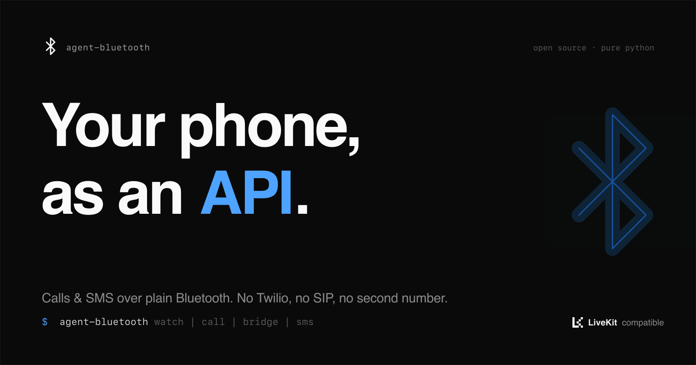

# Agent Bluetooth



**Turn any phone into an API — calls and SMS — over plain Bluetooth.**

Pair a cheap always-on box (Raspberry Pi, Orange Pi, any Linux machine with a
Bluetooth dongle) to your phone as if it were a car kit. Your real number, with
no Twilio, no SIP, no second line, becomes programmable: incoming calls open a
LiveKit room you (or an AI agent) can join and talk, SMS and 2FA codes forward
anywhere, and everything is scriptable from one CLI.

Leave the phone in a drawer; use its line from your laptop, a server, or an
agent.

> Inspired by an idea from **[Grigory Bakunov (@bobuk)](https://github.com/bobuk)** —
> a phone as a universal Bluetooth-attached controller. This is a small, hackable
> build of it. Weekend project; expect rough edges.
>
> Not affiliated with LiveKit. It just uses [LiveKit](https://livekit.io) to bridge
> your phone's calls into a room you — or an AI agent — can join.

## What you can do

- **Answer your phone from anywhere** — each call becomes a LiveKit room; join
  from a laptop (even abroad, no roaming) or hand it to an AI voice agent.
- **Let an agent make and take calls on your number** — dispatch a LiveKit agent
  into the room; it gets the caller's number in metadata.
- **Get your SMS & OTP codes where you are** — forward a code to Telegram, an SMS
  to a webhook, auto-reply when you can't pick up.
- **Record or play audio** — voicemail greetings, IVR prompts, call recording.
- **Rules, no code** — "on event X, do Y" automations (block spam, OTP relay,
  driving auto-reply).

Same options apply to incoming and outgoing calls: answer in an app, send to an
agent, play a recording, or record.

## How it works

```
   your phone ──Bluetooth(HFP/MAP/PBAP)──► box (this software) ──► LiveKit room
                                                │                      ▲
                                        events + HTTP API        you / an agent
```

Pure-Python ([Bumble](https://github.com/google/bumble) — no BlueZ needed). Four
swappable layers behind ports — `phone`, `messages`, `bridge`, `sink` — wired by
one `config.toml`. A native macOS softphone (`apps/AgentPhone`) and a web demo
ship with it; or drive everything from the `agent-bluetooth` CLI.

## Quick start (no hardware)

```bash
uv sync
livekit-server --dev                            # terminal 1
uv run agent-bluetooth serve config.demo.toml   # terminal 2
open http://localhost:8080                       # press "call" under Simulate
```

Real phone: copy `config.example.toml` → `config.toml`, set your Bluetooth
transport + LiveKit creds, pair the phone with **"Agent Bluetooth"**. See
[docs/SETUP.md](docs/SETUP.md). Agents: run `agent-bluetooth guide`.

## Hardware note

Use a **genuine CSR8510 USB dongle** (e.g. TP-Link UB400). Counterfeit CSR
clones enumerate but drop the call link within minutes — avoid them. On
Raspberry/Orange Pi the onboard Bluetooth can't carry call audio (SCO over PCM,
not USB), so the USB dongle is required for voice.

## Status

Verified on real hardware: pairing, SMS (MAP), contacts/history (PBAP), incoming
and outgoing calls, and call audio published into a LiveKit room. It's a
starting point to build on — every capability is an adapter you can swap.
See [docs/DESIGN.md](docs/DESIGN.md) for the roadmap.
