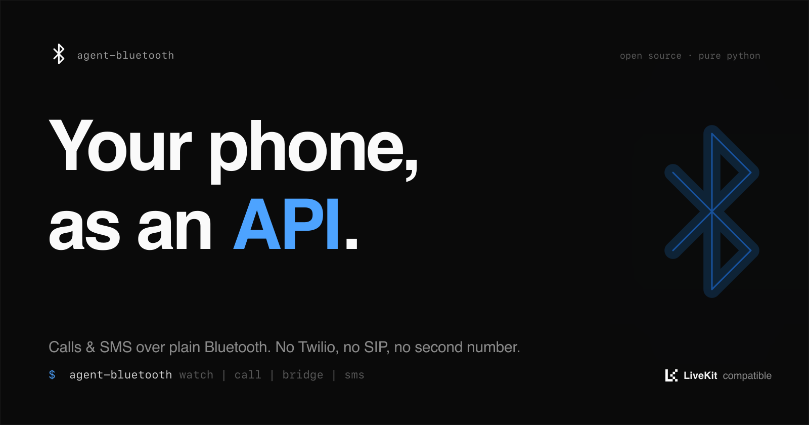
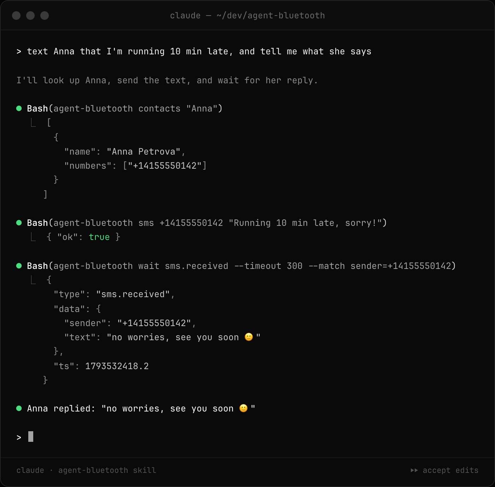
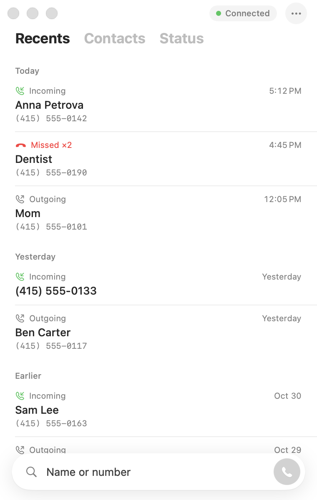
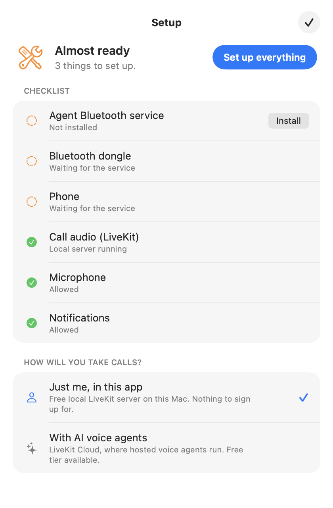
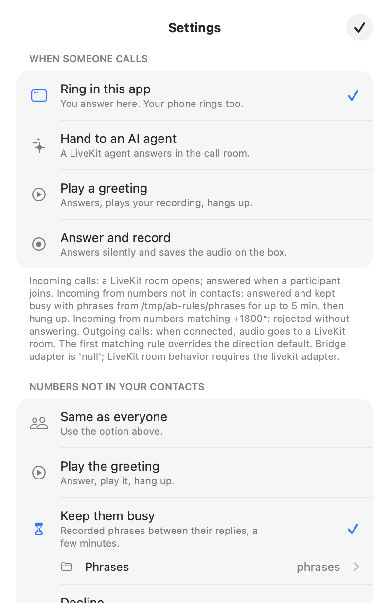

**Teach your agent to make phone calls for you.** Plug a $15 Bluetooth dongle
into your computer, pair a phone, and a [LiveKit](https://livekit.io) voice
agent can call anyone from your real number: book a table, sit through a phone
menu, chase a refund. No Twilio, no SIP trunk, no new number.

```bash
agent-bluetooth call +14155550142 --agent phone-agent \
  --task "Book a table for two tonight at 7, under Sam"
```

The phone dials, the agent waits for someone to pick up, handles the
conversation, hangs up, and saves the transcript.

<p>
  
  
</p>

- **Calls, both ways.** Your agent places calls and answers them. Each call
  is a LiveKit room with your phone in it as a SIP participant (DTMF
  included), so anything built for LiveKit telephony works unchanged.
- **You stay in the loop.** Type `agent-bluetooth say "make it 8 instead"`
  mid-call and the agent says it, in its own voice. Press *Take over* in the
  Mac app and it hands the caller to you. When the call ends, it texts you
  what came of it (`call.summary`).
- **Recording**: one switch records every call, both sides in stereo.
- **Texts** (Android): send, list, wait for a reply, and `otp on` to forward
  every login code to Telegram.
- **Contacts and call history**, synced from the phone.
- **A CLI and HTTP API** that print JSON, plus a **Claude Code skill**, so a
  coding agent can text and call too.
- **Agent Phone**, a small macOS softphone
  ([download](https://github.com/Hormold/agent-bluetooth/releases/latest)).

## You need

- A USB Bluetooth dongle. Tested: [TP-Link UB400](https://www.amazon.com/dp/B07V1SZCY6).
- A Mac or any Linux machine to plug it into.
- Any phone that can connect to a Bluetooth headset.

## Run it

```bash
brew install libusb livekit            # Linux: libusb-1.0-0 + livekit-server
git clone https://github.com/Hormold/agent-bluetooth && cd agent-bluetooth
uv tool install . && cp config.example.toml config.toml   # puts `agent-bluetooth` on PATH

livekit-server --dev --bind 127.0.0.1 --node-ip 127.0.0.1 &
agent-bluetooth serve config.toml
```

Pair your phone with **Agent Bluetooth**. If the dongle doesn't come up,
`agent-bluetooth status` says why and what to do. More (Linux, systemd,
call modes): [docs/SETUP.md](docs/SETUP.md).

## From an agent

```bash
agent-bluetooth sms +14155550142 "Running 10 min late"
agent-bluetooth wait sms.received --match sender=+14155550142
agent-bluetooth call +14155550142 && agent-bluetooth wait call.active
agent-bluetooth dtmf 1
agent-bluetooth say "Ask if they take walk-ins too"   # the agent says it next
agent-bluetooth wait call.summary                     # how the call went
agent-bluetooth otp on                                # login codes -> Telegram
agent-bluetooth contacts anna
agent-bluetooth debug                  # when something's off
```

Every command prints JSON. For Claude Code, copy the skill:
`cp -r skills/agent-bluetooth ~/.claude/skills/`. Then just ask it to text or
call someone. Full recipe: `agent-bluetooth guide`.

## Your agent makes the call

[examples/livekit-agent](examples/livekit-agent) is a complete voice agent on
[LiveKit Agents](https://docs.livekit.io/agents/): one file, both directions,
and it listens to you: `say` lines, take-overs, and a one-line report of every
call posted back to the daemon.

```bash
cd examples/livekit-agent && cp .env.example .env    # add OPENAI_API_KEY
uv sync && uv run python agent.py                    # registers "phone-agent"

agent-bluetooth call +14155550142 --agent phone-agent --task "Ask if they're open Sunday"
```

Or start it the LiveKit way, exactly like LiveKit's
[outbound calls guide](https://docs.livekit.io/telephony/making-calls/outbound-calls/),
just without a SIP trunk:

```bash
lk dispatch create --new-room --agent-name phone-agent \
  --metadata '{"phone_number": "+14155550142", "task": "Ask if they are open Sunday"}'
```

To have it answer your calls as well:
`agent-bluetooth settings set incoming=agent agent_name=phone-agent`.
How the phone shows up in the room: [docs/LIVEKIT.md](docs/LIVEKIT.md).

### Why LiveKit

[LiveKit](https://github.com/livekit/livekit) is the open-source realtime
stack this is built on: rooms, WebRTC, and
[Agents](https://github.com/livekit/agents), the framework for voice agents
with any STT, LLM and TTS (or a realtime model). `livekit-server --dev` runs it
on your laptop; [LiveKit Cloud](https://cloud.livekit.io) hosts it when your
agent needs to be reachable from anywhere. agent-bluetooth only adds the
missing piece: a real phone line in the room.

## Send an AI to wait on hold for you

The calls nobody wants to make: the insurer, the airline, the utility, the bank. Forty minutes of "press 3", a code to type, hold music, and
"we are receiving more calls than we can answer". Hand that to an agent:

```bash
cd examples/livekit-agent
./ivr.sh worker profiles/local/insurer.json &          # the agent, tuned for that line
./ivr.sh redial profiles/local/insurer.json "Ask why my refund hasn't arrived"
```

- **It walks the menu**: keys, short spoken answers, verification codes,
  "say representative". Once it knows a line, plain rules in a JSON profile
  walk it with no model at all.
- **It waits.** Hold music, transfers, a full queue: it redials every ten
  minutes until a person picks up or the lines close.
- **It asks you, not the stranger.** When the menu wants something it
  doesn't know, a question card pops up in Agent Phone. You type the answer,
  and only the agent sees it.
- **It calls you in.** When a real person answers, Agent Phone jumps to the
  front with a red frame and a sound: *A person is on the line*. Turn your
  mic on and talk; you've been listening the whole time.
- **Your coding agent tunes it.** Claude reads the call log, writes the menu
  rules and redials, with the [phone-menu-calls](skills/phone-menu-calls/SKILL.md)
  skill. Account numbers and dates of birth stay in env vars, masked in every log.

The question card, the alert and the Say box work for any LiveKit agent you
write: mix in [`owner_tools.py`](examples/livekit-agent/owner_tools.py), and
see [docs/OWNER.md](docs/OWNER.md) for the API.

## Mac app

<p>
  
  
  
</p>

**[Download Agent Phone for macOS](https://github.com/Hormold/agent-bluetooth/releases/latest)**
(signed and notarized, macOS 14+). Unzip, drag it to Applications, open.

Or build it yourself:

```bash
apps/AgentPhone/install.sh       # builds it and installs "Agent Phone" into /Applications
```

On first launch it checks everything it needs (the service, the dongle, the
phone, LiveKit, microphone, notifications) and sets up what it can with one
button: installs and starts the local service and LiveKit through Homebrew and
uv, or connects LiveKit Cloud if you want hosted voice agents. Then it's a
phone: recents, contacts, keypad, incoming call alerts, and a choice of what
happens when someone calls.

## Ideas

- **The assistant button.** A headset has one, and so does this box:
  `agent-bluetooth assistant on` sends `AT+BVRA=1`, which asks the phone to
  wake Siri or Gemini and open the audio link to the box, with no call.
  Anything the assistant can do (messages, reminders, the lights) becomes
  something your agent can ask for. Experimental: whether the phone opens the
  link while locked depends on the phone; see the changelog.
- **A phone in a drawer.** Keep an old phone on the dongle at home. Forward
  your number to it (or give it out as your public number) and the agent
  answers, screens spam, and texts you what matters.
- **Calls on your real phone, through your agent.** A small app that rings
  your own phone with the call your agent picked up, so it can hand a caller
  over to you. Next example.

## Docs

[Setup](docs/SETUP.md) · [LiveKit](docs/LIVEKIT.md) · [You and your agent](docs/OWNER.md) · [Many phones](docs/FARM.md) · [Troubleshooting](docs/TROUBLESHOOTING.md) · [Changelog](CHANGELOG.md) · [Contributing](CONTRIBUTING.md)

Inspired by an idea from [Grigory Bakunov (@bobuk)](https://github.com/bobuk).

## License

[MIT](LICENSE).
